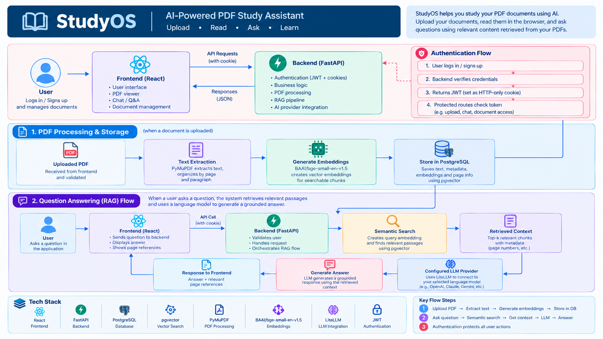

# StudyOS — AI-Powered PDF Study Assistant

StudyOS is a web application that helps students study PDF documents using AI. Upload a document, read it in the browser, and ask questions grounded in relevant content retrieved from your PDFs.

Built with React, FastAPI, PostgreSQL, vector search, and LiteLLM, StudyOS explores how retrieval-augmented generation (RAG) can make learning from documents more interactive.



## Demo

**Demo video:** [Watch StudyOS in action](https://www.youtube.com/watch?v=w26d7C3KgVw)

*Replace the placeholder with your demo video link when you upload it.*

## Features

- **PDF uploads:** Upload and manage study documents.
- **PDF viewer:** Read documents directly in the application.
- **Document processing:** Extract text and organize content by page and paragraph.
- **Semantic search:** Find relevant document passages using vector embeddings.
- **AI document chat:** Ask questions about uploaded PDFs and receive context-grounded answers.
- **Page references:** Identify relevant document pages to help verify AI responses.
- **Authentication:** Protect user-specific operations with authenticated sessions and HTTP-only cookies.
- **Configurable AI providers:** Connect supported language models through LiteLLM.

## Tech Stack

| Component | Technology |
|---|---|
| Frontend | React, Vite, React Router |
| Backend | Python, FastAPI |
| Database | PostgreSQL, SQLAlchemy |
| Vector search | pgvector |
| PDF processing | PyMuPDF |
| Embedding model | BAAI/bge-small-en-v1.5 |
| LLM integration | LiteLLM |
| Authentication | JWT with HTTP-only cookies |

## How It Works

1. **Upload:** The user signs in and uploads a PDF through the frontend.
2. **Extract:** The backend extracts document text and organizes it into searchable passages.
3. **Embed:** The embedding model converts eligible passages into vector representations.
4. **Store:** PostgreSQL stores document content, metadata, and embeddings using pgvector.
5. **Retrieve:** When the user asks a question, the backend searches for relevant passages using vector similarity.
6. **Generate:** The retrieved context is sent to the selected language model through LiteLLM.
7. **Respond:** The application returns an answer with relevant page references where available.

## Getting Started

### Prerequisites

- Python 3.12 or a compatible version
- Node.js and npm
- PostgreSQL with the pgvector extension
- Git
- Credentials for a language-model provider supported by your configuration

### 1. Clone the repository

```bash
git clone YOUR_PUBLIC_REPOSITORY_URL
cd StudyOS
```

Replace `YOUR_PUBLIC_REPOSITORY_URL` with your public GitHub repository URL.

### 2. Configure PostgreSQL

Create a database for StudyOS and enable the pgvector extension:

```sql
CREATE EXTENSION IF NOT EXISTS vector;
```

Configure the backend's database connection using the environment variable names expected by the application.

### 3. Set up the backend

```bash
cd backend

python3 -m venv studyenv
source studyenv/bin/activate

pip install -r requirements.txt
```

Configure the required environment variables, including database credentials, authentication secrets, and the selected AI provider's credentials.

Start the backend:

```bash
uvicorn app.main:app --reload
```

The API should be available at:

`http://127.0.0.1:8000`

Interactive API documentation:

`http://127.0.0.1:8000/docs`

### 4. Set up the frontend

Open a separate terminal from the project root:

```bash
cd frontend

npm install
npm run dev
```

Open the local URL displayed by Vite, typically:

`http://localhost:5173`

Ensure the frontend API URL and backend CORS configuration match your local environment.

### 5. Configure AI integration

Select a language-model provider supported by the application and configure its credentials as required.

Keep API keys and other secrets in environment variables. Never commit credentials or `.env` files to the public repository.

## Engineering Highlights

- Built a full-stack application with React and FastAPI.
- Implemented PDF text extraction and document processing.
- Integrated embedding generation and semantic retrieval.
- Used PostgreSQL and pgvector for vector similarity search.
- Connected retrieved document context to language-model inference through LiteLLM.
- Implemented authenticated access using JWTs and HTTP-only cookies.
- Associated retrieved passages with document page information for answer verification.

## Security and Privacy

- Keep API keys, passwords, and authentication secrets out of version control.
- Validate uploaded files and enforce appropriate upload limits.
- Ensure users can access only their own protected documents.
- Keep private experimental code and sensitive data out of the public repository.
- Treat retrieved document content as untrusted input when constructing AI prompts.

## Future Improvements

- Docker-based deployment
- Improved PDF processing status and progress reporting
- Better retrieval evaluation and answer quality
- Page based query and summery
- Automated tests for authentication, uploads, and AI endpoints
- Production deployment with persistent storage and monitoring
- Creating a personalized AI agent to help you

## License

A license has not yet been specified. Add a license file if you intend to grant others permission to reuse, modify, or distribute this project.

---

*StudyOS is a personal project exploring full-stack development, database-backed semantic search, and AI-powered learning applications.*
